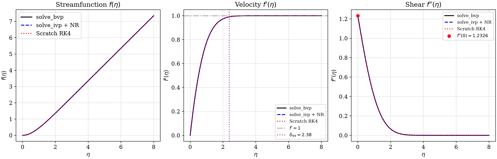
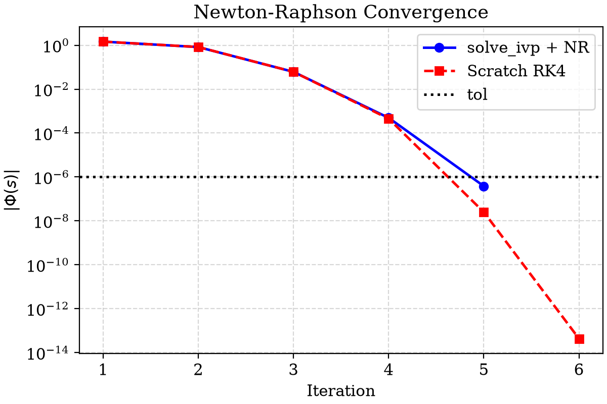
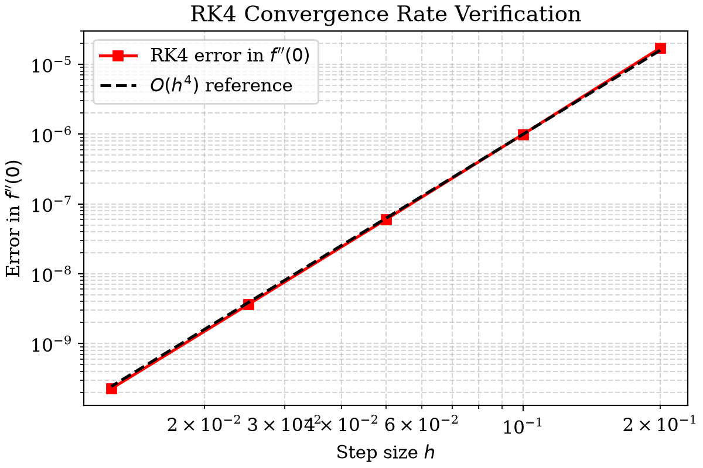
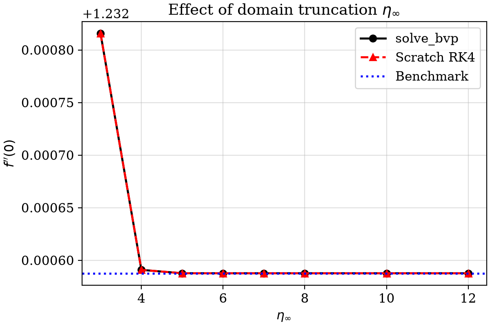
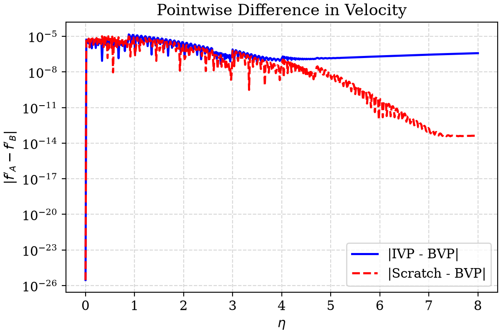
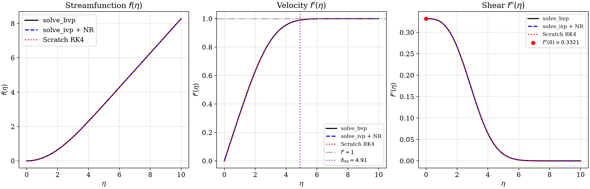
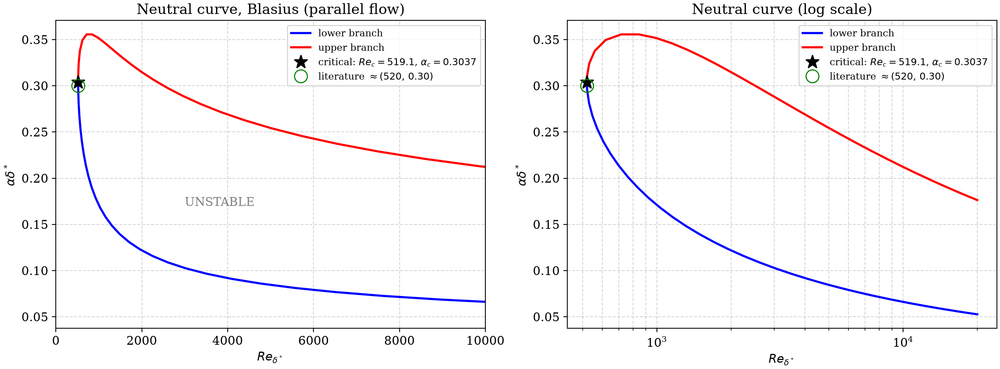
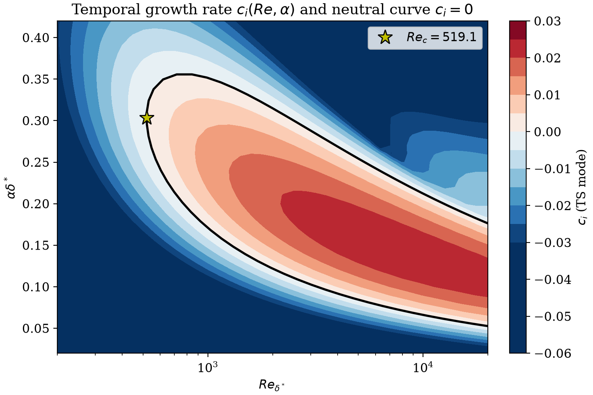
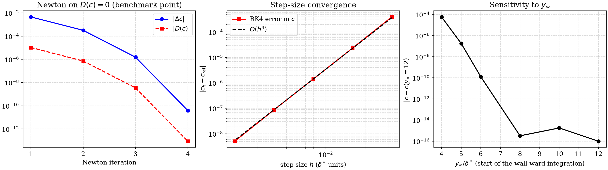

# Assignment 01 — Boundary-Layer Similarity Solutions & Orr–Sommerfeld Stability

Two cases, both run from one entry point (`main.py`). The Orr–Sommerfeld case always computes its Blasius base flow first.

| Case | Equation | What is computed |
|---|---|---|
| **Falkner–Skan** (stagnation point) | $f''' + ff'' - (f')^2 + 1 = 0$ | $f''(0)$, profiles, $\delta^*$, $\theta$, $H$ with three methods |
| **Orr–Sommerfeld** (Blasius, parallel flow) | stage 1: $f''' + \tfrac12 ff'' = 0$ (three methods)<br>stage 2: $(U-c)(\phi''-\alpha^2\phi) - U''\phi = \frac{1}{i\alpha Re}(\phi''''-2\alpha^2\phi''+\alpha^4\phi)$ | Blasius base flow, then eigenvalue $c(\alpha, Re)$ by shooting from $y_\infty$ to the wall, growth-rate map, neutral curve, critical $Re$ |

All with $f(0)=0$, $f'(0)=0$, $f'(\infty)=1$ for the similarity problems, and $\phi(0)=\phi'(0)=0$, $\phi\to0$ as $y\to\infty$ for Orr–Sommerfeld.

## Files

```
Assignment_01_24JE0271/
├── main.py                        ← run this (CLI: falkner-skan | orr-sommerfeld | all)
├── REQUIREMENTS.txt
├── Falkner_Skan_Report.pdf        ← compiled Falkner–Skan report
├── src/
│   ├── solve_bvp_approach.py      Falkner–Skan, Approach 1: solve_bvp (collocation)
│   ├── solve_ivp_newton.py        Falkner–Skan, Approach 2: solve_ivp + Newton-Raphson
│   ├── scratch_rk4_newton.py      Falkner–Skan, Approach 3: RK4 + Newton-Raphson from scratch
│   ├── blasius_bvp_approach.py    Blasius, Approach 1: solve_bvp
│   ├── blasius_ivp_newton.py      Blasius, Approach 2: solve_ivp + Newton (FD Jacobian)
│   ├── blasius_scratch_rk4.py     Blasius, Approach 3: scratch RK4 + Newton (sensitivity eqs)
│   ├── blasius_case.py            Blasius stage of the OS run: tables + figures
│   ├── orr_sommerfeld.py          OS solver: Blasius base flow, compound-matrix shooting
│   │                              (y_inf → wall, RK4), Newton for c, (Re, α) sweep,
│   │                              neutral-curve refinement, critical point
│   └── orr_sommerfeld_case.py     OS driver: Blasius stage, then validation, sweep, figures + tables
└── latex_report/
    ├── Falkner_Skan/              report.tex, comparison_table.tex, figures/
    └── Orr_Sommerfeld/            combined Blasius + Orr–Sommerfeld report:
                                   report.tex, blasius_table.tex, results_table.tex,
                                   neutral_points_table.tex, run_parameters.tex,
                                   neutral_curve.csv (git-ignored), figures/ (blasius_*.png + OS)
```

Everything under `latex_report/*/` except `report.tex` is auto-generated by `main.py`. Compile each `report.tex` from inside its own folder (e.g. upload the folder to Overleaf).

## Setup

```bash
git clone https://github.com/HibernatingBunny067/Assignment_01_24JE0271.git
cd Assignment_01_24JE0271
python3 -m venv .venv
source .venv/bin/activate
pip install -r REQUIREMENTS.txt
```

## Running

```bash
python main.py                         # Falkner–Skan (default)
python main.py falkner-skan            # same as above
python main.py orr-sommerfeld          # Blasius base flow, then OS sweep + neutral curve  (~2.5 min)
python main.py orr-sommerfeld --quick  # same, coarser OS grid, same Re_c                  (~1 min)
python main.py all                     # everything
```

Individual solvers can also be run on their own:

```bash
python src/solve_bvp_approach.py       # Falkner–Skan
python src/solve_ivp_newton.py
python src/scratch_rk4_newton.py
python -m src.blasius_bvp_approach     # Blasius base-flow solvers
python -m src.blasius_ivp_newton
python -m src.blasius_scratch_rk4
python -m src.orr_sommerfeld           # OS benchmark eigenvalue only
```

## Orr–Sommerfeld method in short

1. **Base flow** — Blasius equation solved three ways (stage 1); Blasius $f''(0)$ from `solve_bvp`, re-integrated with DOP853 and rescaled so lengths are in $\delta^*$ ($Re = Re_{\delta^*}$).
2. **Start at $y_\infty$** (= 8 $\delta^*$): in the freestream $U = 1$, so the two decaying solutions are $e^{-\alpha y}$ and $e^{-\gamma y}$, $\gamma^2 = \alpha^2 + i\alpha Re(1-c)$.
3. **Integrate down to the wall** with RK4, carrying the 2×2 minors of the two solutions (compound-matrix method), which avoids parasitic growth of the viscous solution.
4. **Wall condition** $\phi(0) = \phi'(0) = 0$ ⇔ $D(\alpha, Re, c) = \phi_1\phi_2' - \phi_2\phi_1' = 0$ at $y = 0$, solved for complex $c$ by Newton–Raphson.
5. **Sweep** a log-$Re$ × $\alpha$ grid with continuation of the TS mode, contour $c_i = 0$, refine each point (real $c$, 2×2 Newton), and minimise $Re$ on the curve for the critical point.

## Results

### Falkner–Skan











### Orr–Sommerfeld (Blasius, parallel flow)

Blasius base flow: $f''(0) = 0.3320573$, $\delta^* = 1.7208$, $\theta = 0.6641$, $H = 2.591$.



Benchmark $c$ at $Re_{\delta^*} = 998$, $\alpha\delta^* = 0.308$ reproduced to $10^{-7}$; critical point $Re_{\delta^*,c} \approx 519.1$, $\alpha_c\delta^* \approx 0.304$, $c_r \approx 0.397$.






